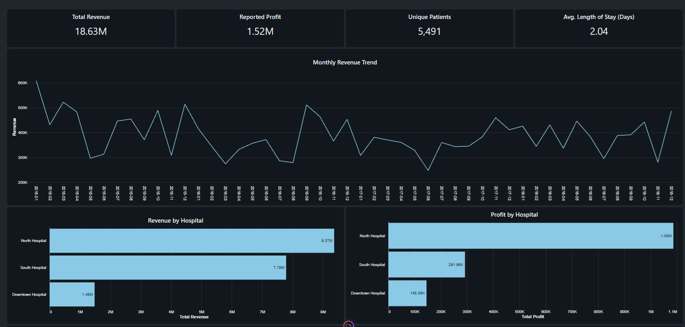
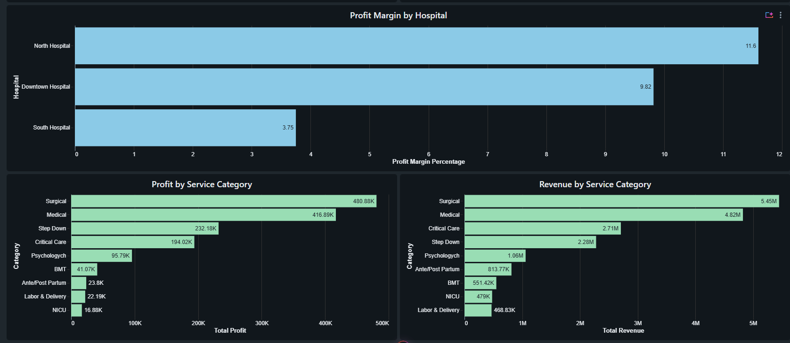
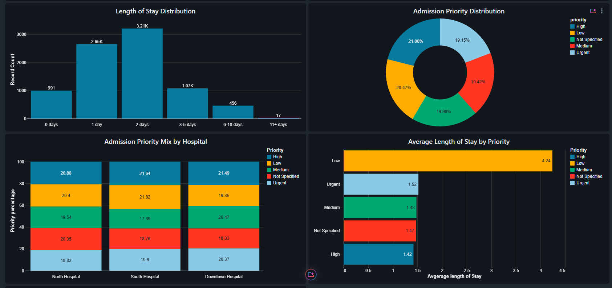
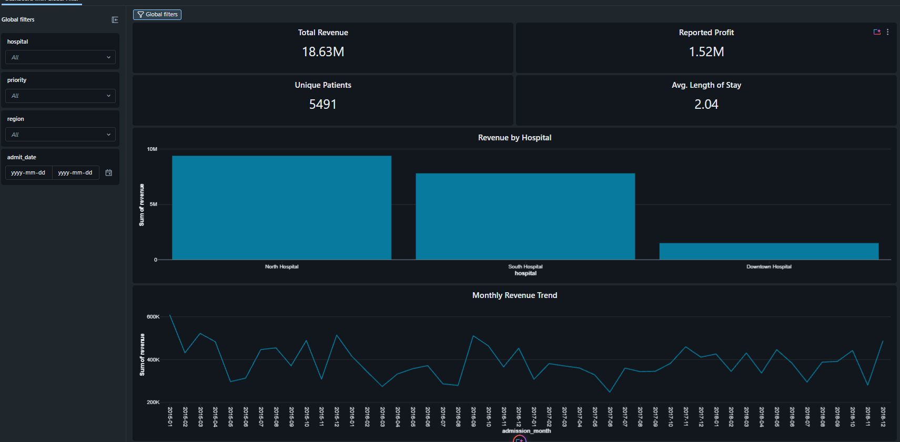

# Hospital Patient Analytics | Databricks

**Independent data analytics portfolio project** | Databricks · PySpark · SQL · Delta Lake · AI/BI Dashboards

**Prepared by Amin Sinaei**,**October 2026**

## Project overview
This project explores hospital service activity, reported financial performance, admission patterns, and length of stay using a training dataset. The objective is to turn source records into a validated analytical table and present useful operational and financial comparisons in Databricks dashboards.

## Data and workflow
- **Source:** 8,392 records across 19 original fields (training dataset).
- **Preparation:** Schema review, null/duplicate checks, validation of dates and financial values, column-name normalization, string cleanup, and ZIP code standardization.
- **Modeling:** Added length of stay, admission month, and reported profit-margin percentage; stored the resulting **8,392-row, 22-column** analytical dataset as a Delta table.
- **Presentation:** Two Databricks AI/BI dashboards: a multi-chart analytical overview and an interactive dashboard with shared filters for hospital, priority, region, and admission date.

## Headline metrics (unfiltered)
| Metric | Result |
| --- | ---: |
| Total reported revenue | $18.63M |
| Total reported profit | $1.52M |
| Distinct patient IDs | 5,491 |
| Average length of stay | 2.04 days |

## Selected observations
- North Hospital accounted for approximately **$9.37M** in reported revenue, compared with **$7.79M** at South Hospital and **$1.48M** at Downtown Hospital.
- Surgical services contributed approximately **$5.45M** in reported revenue, followed by Medical services at **$4.82M**.
- The Low admission-priority category showed a higher average length of stay (**4.24 days**) than other priority groups; this is a descriptive result, not a clinical conclusion.
- Revenue and length of stay had negligible linear correlation in this dataset (Pearson r approximately **0.0114**).

## Dashboard previews

More screenshots are available in the [`images/`](screenshots/) folder. For a concise explanation of objectives, analytical methods, observations, and limitations, see [Project Overview (PDF)](Project_Overview.pdf).

## Important interpretation notes
- Figures reflect **source-reported** financial fields. The reported profit values did not reconcile consistently to simple revenue/cost/discount formulas and were not independently validated.
- A record is not necessarily a unique patient: patient IDs recur. Distinct patient IDs and total records are reported separately.
- Length of stay is calculated from discharge date minus admission date, at the record level.
- This is an independent portfolio analysis of a training dataset, not a real-world hospital performance audit or medical study.

## Repository scope
This repository is designed as an **analytics portfolio presentation** rather than a complete executable code release. It contains project documentation and dashboard screenshots, not the underlying SQL queries or a live Databricks workspace.
